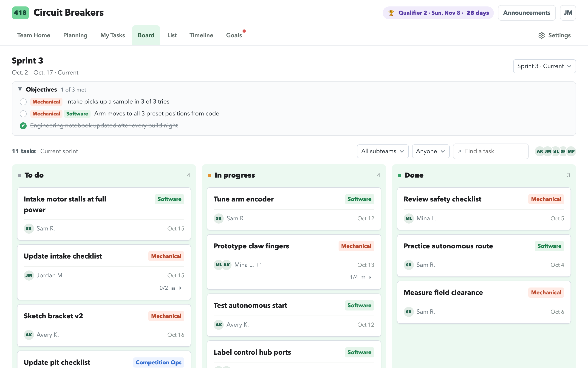
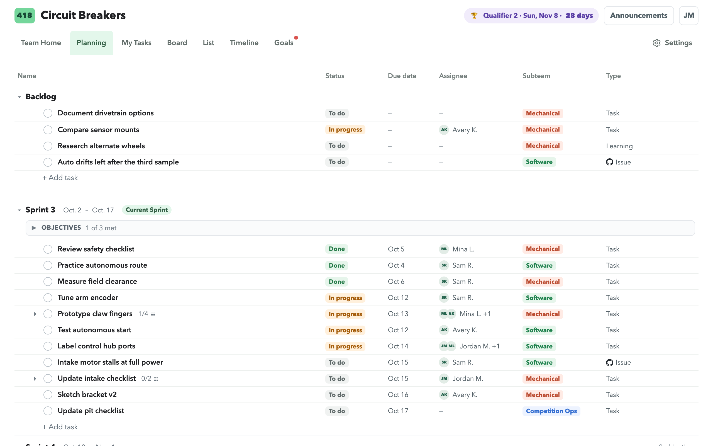
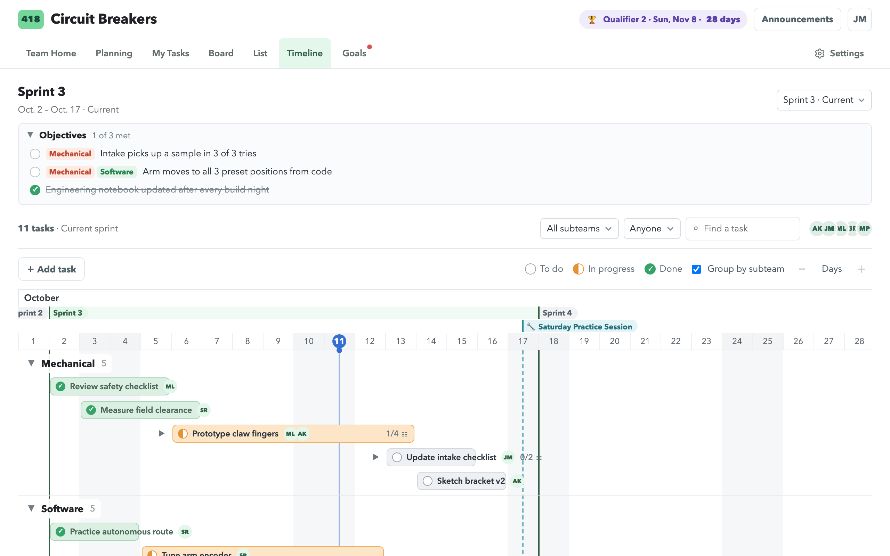
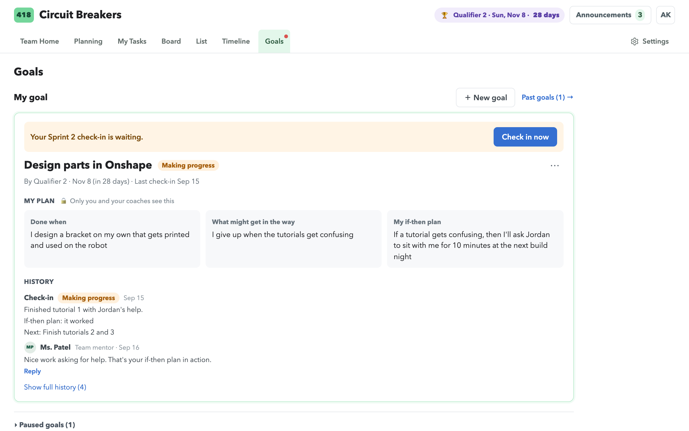
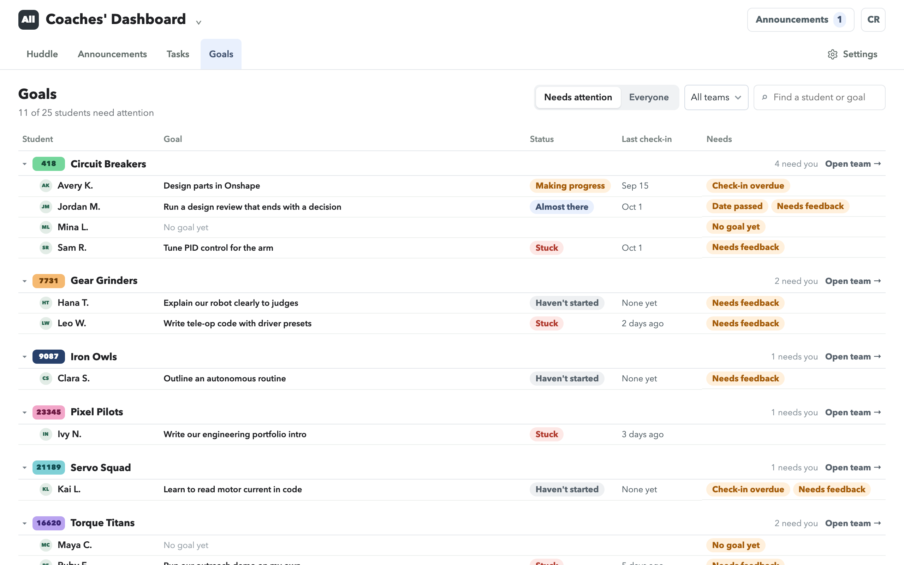
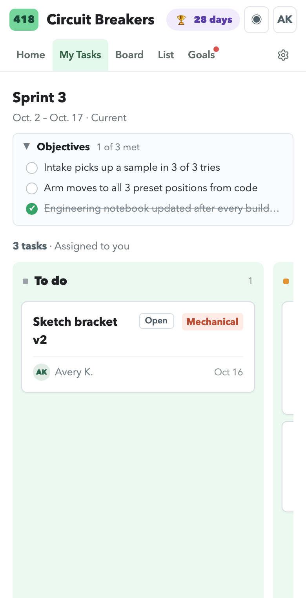
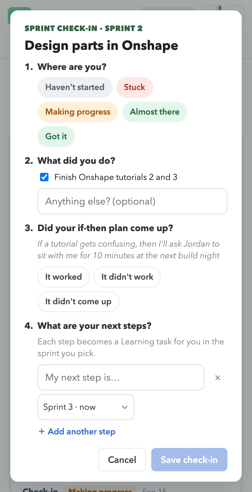

# Switchback

### Project management for student teams, clubs, and class projects.

Switchback starts with high quality team task lists, boards, sprints, and timelines like most project-management tools. Then adds learning goals and coach/teacher tools designed to help students learn from their team-based projects.

Switchback is a free, open-source web app that a school or club runs for itself. It's simple enough for middle schoolers, capable for the high-level college engineering teams, and is built around student privacy.



## Why it exists

Student teams need somewhere to plan their work. The tools built for companies are either too complex and cluttered for students new to project management or a school can't approve them because of how they handle student data. Switchback is designed explicitly for student teams in an app each organization hosts in its own account to ensure student privacy is protected.

## A look around

**Planning.** Team leads and coaches plan in sprints. Order is priority: drag a task up and it matters more. Drag it onto another sprint to save it for later.



**Timeline.** The same tasks across the season's calendar. Drag a bar to move it, or drag an end to change a date.



**Learning goals.** Each student sets a one or more personal learning goals. Switchback prompts them to make a plan to achieve their goal and then asks them to check and reflect in every sprint. Coaches and mentors reply with feedback and resources.



**Coaches' Dashboard.** Every team's goals and tasks in one place, sorted by who needs something.



**Phones and Chromebooks.** Everything works on a small screen.

<p>
  
  &nbsp;&nbsp;
  
</p>

## Student, Student Lead, Mentor, and Coach Roles

| For             | What                                                                                                                                              |
| --------------- | ------------------------------------------------------------------------------------------------------------------------------------------------- |
| Students        | **My Tasks** (just this sprint's tasks that are yours), the team **Board**, **List**, and a **learning goal** with a check-in each sprint         |
| Team leads      | **Planning** (backlog, sprints, objectives) and the **Timeline**; they can also change the team's name, color, and subteams                       |
| Mentors         | Their teams' boards and goals, feedback on check-ins, and team membership                                                                         |
| Program coaches | The **Coaches' Dashboard** across every team, a daily **Huddle** for the adults, **Announcements**, and program settings (seasons, teams, people) |
| Everyone        | **Team Home** (notes and events), **Announcements**, subtasks, comments, and drag and drop                                                        |

Optional, and off until you turn them on:

- **Email** for announcements and huddles ([docs/email.md](docs/email.md)).
- **GitHub issues as tasks**, for teams that write code ([docs/github.md](docs/github.md)).

## Built for student privacy

Switchback is meant for students, including those under 13.

- **It stores very little.** A display name (first name and last initial), a role, a team, and what people create in the app. Member lists never show email addresses.
- **The rules are enforced by the database, not just the screen.** Students can read only their own team's work and their own goals. [firestore.rules](firestore.rules) is the list of who can read and write what, and 100+ tests check it every time the code it deployed.
- **No ads, trackers, or third-party scripts.** The page loads nothing from anyone else.
- **Adults talk to students in the open.** A coach's feedback is visible to every coach of that team. There are no private one-to-one messages between an adult and a student.
- **Your data stays yours.** Each organization runs its own copy in its own Firebase project and decides its own policies.

## Try it on your computer

You don't need a Firebase account for this. Everything runs locally with made-up data.

You need [Node.js](https://nodejs.org) 22.18 or newer, and Java 21 or newer (for the Firebase emulators).

```sh
npm install
npm start            # starts the local database and the app at http://localhost:5173
```

Then, in a second terminal:

```sh
npm run seed:demo    # loads "Example Robotics": 7 teams, 32 people, tasks, goals
```

Open http://localhost:5173 and choose **Sign in with Google**. A local stand-in appears with the sample people. Each
one shows you a different view:

| Sign in as                 | To see                                       |
| -------------------------- | -------------------------------------------- |
| `avery.k@example.edu`      | A student whose sprint check-in is due       |
| `mina.l@example.edu`       | A student setting their first goal           |
| `jordan.m@example.edu`     | A team lead, with Planning and the Timeline  |
| `ms.patel@example.edu`     | A mentor                                     |
| `coach.rivera@example.edu` | A program coach, with the Coaches' Dashboard |

Run `npm run seed:demo` again any time to put the sample data back.

## Use it for your own program

Switchback runs on [Firebase](https://firebase.google.com), and the free plan is enough for a program of about 100 people.

1. Create a Firebase project under your organization's Google account.
2. Describe your program in `program.config.json`: its name, how people sign in (Google accounts on your domain, email and password, or both), and the first coach.
3. Run `npm run setup`, then deploy.

[docs/configuration.md](docs/configuration.md) walks through each step.

Before real students use it, check with your organization about parental consent, what your agreements cover, and
how long data is kept. The app is designed to hold as little as possible, but those decisions are yours.

## How it's built

A single-page app in [Vue 3](https://vuejs.org) and TypeScript, built with [Vite](https://vite.dev), on Firebase
(sign-in, the Firestore database, and hosting). There is no server of our own: the browser talks to the database
directly, and the security rules decide what each person may do.

If you'd like to read the code, start with the **[code tour](docs/code-tour.md)**. It explains how the pieces fit
and suggests a first file to open.

## Want to help?

You're welcome to, whether you're a student, a coach, or neither. [CONTRIBUTING.md](CONTRIBUTING.md) has the ground
rules (privacy comes first), how to get set up, and what to run before you open a pull request.

To report a security or privacy problem, please don't open a public issue. Use the repository's Security tab →
"Report a vulnerability". [SECURITY.md](SECURITY.md) has the details.

## Project status

- [x] **Every page works**, on computers and phones, and the checks run on every pull request.
- [x] **Email through Gmail** (a Google Apps Script), for organizations whose mail is hosted by Google. See
      [docs/email.md](docs/email.md).
- [ ] **Email through a Microsoft webhook**, for organizations whose mail is on Microsoft 365. Not in the code yet:
      a first version was drafted but never tested, and the webhook trigger it relied on needs a paid license. Until
      this exists, read the first section of [docs/email.md](docs/email.md) before installing email.
- [x] **GitHub issues as tasks.** Tested against a stand-in for GitHub and by hand against a real repository.
- [ ] **Reminders for coaches** about goals that need feedback. Not built.
- [ ] **Team chat.** On hold, because of privacy concerns, and because teenagers will default to texting or Discord anyway.

## Docs

- [docs/code-tour.md](docs/code-tour.md): how the code is organized, for anyone reading it for the first time.
- [docs/configuration.md](docs/configuration.md): setting up a deployment.
- [docs/data-model.md](docs/data-model.md): what's stored in the database, and who can read and write it.
- [docs/email.md](docs/email.md): optional email for announcements and huddles.
- [docs/github.md](docs/github.md): optional GitHub issues as tasks.
- [CONTRIBUTING.md](CONTRIBUTING.md): ground rules, setup, and checks for contributors.
- [SECURITY.md](SECURITY.md): how to report a security or privacy problem.
- [CLAUDE.md](CLAUDE.md): notes for a Claude agent helping you edit the code: the rules, decisions, and conventions behind the app.

## License

[MIT](LICENSE). Use it, change it, and share it.
